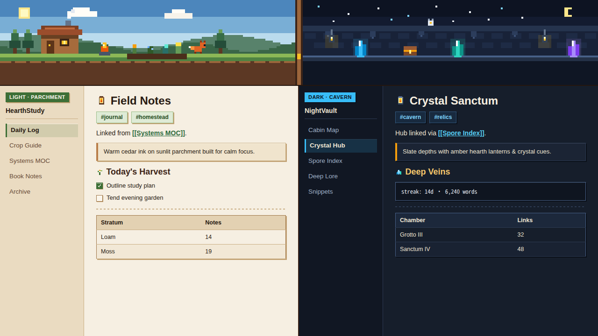

# VaultVale Hearthwood — 16-Bit Pixel Timber & Subterranean Slate Theme for Obsidian



A high-contrast, cozy **16-bit pixel timber & subterranean crystal slate** theme crafted by **HearthCraft Lab** for calm, distraction-free writing — designed to pair seamlessly with the **[VaultVale Community Plugin](https://community.obsidian.md/plugins/vaultvale)**.

- **Light Mode (Hearthwood Parchment)**: Crisp cedar ink (`#291b12`) on sunlit parchment (`#f6efe2`), stepped pixel oak bevel cards, green RPG inventory `#tag` badges, pixel hearth-lantern H1 icons, clover-sprout H2 markers, and pixel task checkboxes.
- **Dark Mode (Subterranean Cavern Slate)**: Warm ivory text (`#eee4d2`) on calm deep slate (`#161e2b`), amber lantern H1 emblems, cyan crystal cluster H2 icons, amber torch borders, and crisp bevel data tables.
- **Zero External Assets**: Pure CSS variables and inline crisp-edge SVG pixel motifs, tabular numerals in tables, zero remote font requests, and readable measure (`44rem`) for long writing sessions.

## Installation

### From Obsidian Community Themes
1. Open **Settings -> Appearance -> Themes -> Manage**.
2. Search for **VaultVale Hearthwood** (or open [VaultVale Hearthwood in the Community Directory](https://community.obsidian.md/themes/vaultvale-hearthwood)).
3. Click **Install and use**.

### Manual Installation
1. Download `manifest.json` and `theme.css` from the [latest GitHub release](https://github.com/maxchoi528/vaultvale-theme/releases/latest).
2. Create the folder `<your-vault>/.obsidian/themes/VaultVale Hearthwood/` and place both files inside it.
3. Reload themes in **Settings -> Appearance -> Themes** and select **VaultVale Hearthwood**.

## Usage & Customization

- Switch between **Light** (**Hearthwood Parchment**) and **Dark** (**Subterranean Cavern Slate**) under **Settings -> Appearance -> Base color scheme**.
- To customize accent colors or reading width via an Obsidian CSS snippet (**Settings -> Appearance -> CSS snippets**), override theme variables cleanly:

```css
.theme-light {
  --interactive-accent: #3d6f36;
  --file-line-width: 48rem;
}

.theme-dark {
  --interactive-accent: #f2aa48;
  --background-primary: #161e2b;
}
```

## Companion Plugin

Pair this theme with the **[VaultVale Obsidian Plugin](https://community.obsidian.md/plugins/vaultvale)** to turn your daily notes, tasks, and folder backlinks into an interactive 16-bit pixel homestead and clickable subterranean knowledge cavern.

- Live Playable Web Sandbox (No Install Needed): [https://vaultvale.pages.dev/](https://vaultvale.pages.dev/)
- Optional Pro Upgrade: [VaultVale Pro on Gumroad](https://yujun57.gumroad.com/l/vaultvale-pro-lifetime)

[MIT License](LICENSE)
